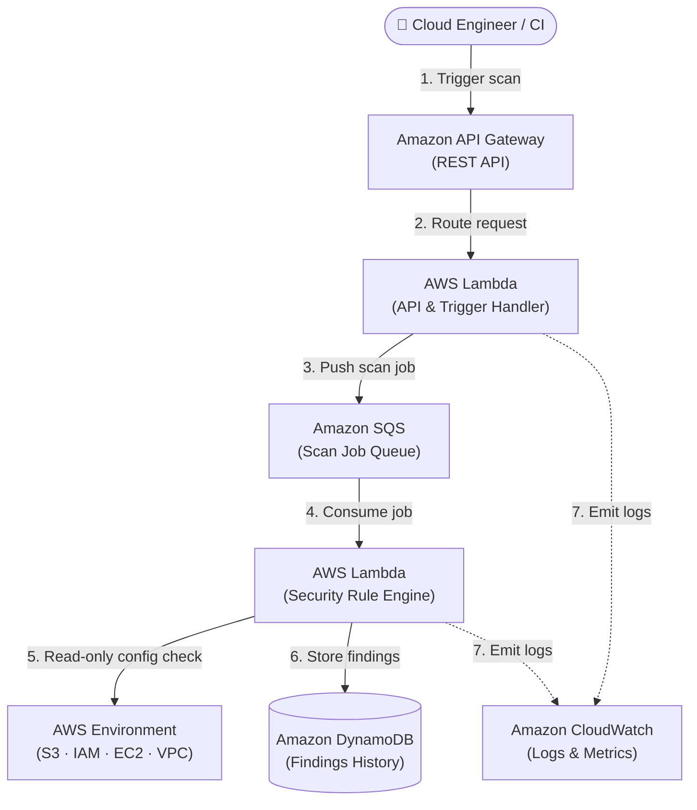

# 🛡️ CloudGuard AWS

### Lightweight, Serverless Cloud Security Posture Scanner

[](LICENSE)
[](https://nodejs.org/)
[](https://aws.amazon.com/sdk-for-javascript/)
[](https://www.terraform.io/)
[](https://github.com/features/actions)

**CloudGuard AWS** is an automated, serverless security scanning engine designed to audit AWS infrastructure against security best practices, flag risky misconfigurations, and deliver structured, evidence-backed remediation guidance without disrupting running services.

---

> [!NOTE]
> **Active Development Notice:** CloudGuard is currently undergoing active MVP development. The roadmap, core rule schemas, and architectural designs below reflect the implementation specification for Phase 1.

---

## ⚡ Key Highlights

* **Read-Only Non-Invasive Auditing:** Scans infrastructure using least-privilege IAM permissions without making unsolicited state changes.
* **Modular Rule Engine:** Extensible security rules evaluated independently against AWS resource configurations.
* **Clear Findings with Remediation Context:** Every finding maps directly to a severity rating, resource identifier, risk explanation, and step-by-step fix.
* **Asynchronous Serverless Pipeline:** Decoupled scan initiation and execution powered by AWS Lambda, SQS, and DynamoDB.
* **100% Infrastructure as Code:** Fully repeatable AWS deployment managed cleanly via Terraform.

---

## 🔍 Security Scope & Detection Rules

CloudGuard targets the most common cloud security misconfigurations that expose organizations to data leaks and unauthorized access:

| Rule ID | Service Area | Target Misconfiguration | Risk Level |
|---|---|---|---|
| `SEC-S3-001` | **Amazon S3** | S3 bucket allows public read/write access | `CRITICAL` |
| `SEC-S3-002` | **Amazon S3** | Bucket does not enforce HTTPS (`aws:SecureTransport`) | `HIGH` |
| `SEC-NET-001` | **EC2 / VPC** | Security Group allows unrestricted inbound SSH (`0.0.0.0/0:22`) | `HIGH` |
| `SEC-NET-002` | **EC2 / VPC** | Security Group allows open inbound RDP (`0.0.0.0/0:3389`) | `HIGH` |
| `SEC-IAM-001` | **AWS IAM** | User or role has wildcard administrative permissions (`*:*`) | `CRITICAL` |
| `SEC-LOG-001` | **CloudTrail** | Multi-region CloudTrail audit logging is disabled | `MEDIUM` |

---

## 🖥️ Sample CLI Output & Finding Schema

When a scan is triggered locally or through the API, CloudGuard outputs structured findings formatted for easy consumption by engineers or automated CI/CD security gates:

```text
$ cloudguard scan --profile audit --region us-east-1

[+] Initializing CloudGuard Scanner v0.1.0...
[+] Authenticated to AWS Account: 123456789012 (Region: us-east-1)
[+] Running 6 checks across S3, IAM, and EC2...

[!] [HIGH] SEC-NET-001 - Unrestricted SSH access found in Security Group
    Resource : sg-0498a12bc8f4 (web-dmz-sg)
    Evidence : Inbound rule allows 0.0.0.0/0 on TCP port 22
    Remedy   : Restrict CIDR block to authorized corporate IPs or use AWS Systems Manager.

[!] [CRITICAL] SEC-S3-001 - Public bucket access detected
    Resource : arn:aws:s3:::customer-export-data
    Evidence : PublicAccessBlockConfiguration allows public policies
    Remedy   : Enable 'Block Public Access' and enforce strict bucket ACLs.

[-] Scan complete: 2 findings identified (1 Critical, 1 High, 0 Medium, 0 Low).
[-] Results written to DynamoDB: cloudguard-findings-table
```

### JSON Finding Schema
```json
{
  "findingId": "cg-20261023-8fbc91",
  "ruleId": "SEC-NET-001",
  "severity": "HIGH",
  "title": "Unrestricted SSH access found in Security Group",
  "resourceType": "AWS::EC2::SecurityGroup",
  "resourceId": "sg-0498a12bc8f4",
  "status": "OPEN",
  "timestamp": "2026-10-23T12:00:00Z",
  "evidence": {
    "protocol": "tcp",
    "port": 22,
    "source": "0.0.0.0/0"
  },
  "remediation": {
    "summary": "Restrict SSH access to approved corporate IP ranges or switch to SSM Session Manager.",
    "documentation": "https://docs.aws.amazon.com/AWSEC2/latest/UserGuide/authorizing-access-to-an-instance.html"
  }
}
```

---

## 🧩 Architecture

CloudGuard is built as a serverless event-driven service to maintain zero idle costs and scale on-demand.



### Why Node.js & AWS SDK v3?
* **Modular Imports:** AWS SDK v3 allows importing discrete clients (e.g., `@aws-sdk/client-s3`) rather than the entire monolithic SDK, drastically reducing Lambda deployment package sizes.
* **Fast Lambda Cold Starts:** Minimal runtime overhead ensures low cold-start latency compared to heavy containers.
* **Concurrent Asynchronous Checks:** Native asynchronous execution handles multi-region and multi-service AWS API calls concurrently using `Promise.allSettled`.

---

## 📁 Repository Structure

```text
cloudguard-aws/
├── .github/
│   └── workflows/
│       ├── test.yml            # Automated unit testing & linting
│       └── terraform.yml       # Terraform validation & security checks
├── src/
│   ├── config/                 # AWS SDK clients and environment configuration
│   ├── rules/                  # Modular security detection rules
│   │   ├── s3/                 # S3 public access and encryption checks
│   │   ├── network/            # Security Group & open port checks
│   │   └── iam/                # IAM wildcard & policy checks
│   ├── engine/                 # Core scanner execution engine
│   ├── handlers/               # AWS Lambda API & SQS entrypoints
│   └── utils/                  # Formatting, logging, and error handling
├── terraform/
│   ├── main.tf                 # Lambda, API Gateway, SQS, and DynamoDB
│   ├── iam.tf                  # Principle of least privilege IAM roles
│   └── variables.tf            # Deployment inputs
├── tests/
│   ├── unit/                   # Rule logic tests using mock AWS responses
│   └── fixtures/               # Sample resource configurations
├── package.json
└── README.md
```

---

## 🛠️ Security Rule Definition Pattern

Rules are authored as clean, single-responsibility functions that accept an AWS resource configuration and return either a structured finding or null:

```javascript
// Example: src/rules/network/unrestrictedSsh.js
export const unrestrictedSshRule = {
  id: "SEC-NET-001",
  severity: "HIGH",
  description: "Check if security group allows inbound SSH from 0.0.0.0/0",
  
  evaluate(securityGroup) {
    const isExposed = securityGroup.IpPermissions?.some(rule => 
      rule.FromPort <= 22 && 
      rule.ToPort >= 22 && 
      rule.IpRanges?.some(range => range.CidrIp === "0.0.0.0/0")
    );

    if (!isExposed) return null;

    return {
      ruleId: this.id,
      severity: this.severity,
      resourceId: securityGroup.GroupId,
      status: "OPEN",
      evidence: { port: 22, source: "0.0.0.0/0" },
      recommendation: "Restrict inbound port 22 access to internal CIDRs."
    };
  }
};
```

---

## 🚀 Getting Started (Local Development)

### Prerequisites
* [Node.js](https://nodejs.org/) (version 20.x or newer)
* [AWS CLI v2](https://docs.aws.amazon.com/cli/latest/userguide/getting-started-install.html) with configured read-only test credentials
* [Terraform](https://www.terraform.io/) (>= 1.5.0)

### Setup
```bash
# 1. Clone the repository
git clone https://github.com/subhajitajodhya-dotcom/cloudguard-aws.git
cd cloudguard-aws

# 2. Install dependencies (once Phase 1 package is published)
npm install

# 3. Run unit tests against rule fixtures
npm test
```

---

## 🗺️ Roadmap

- [x] **Phase 0:** Requirements gathering, architecture specification, and finding schema design.
- [ ] **Phase 1 (Current):** Standalone Node.js rule engine, sample fixtures, and unit test suite.
- [ ] **Phase 2:** AWS SDK integration with S3, Security Group, and IAM policy audit checks.
- [ ] **Phase 3:** Terraform infrastructure deployment (Lambda, SQS, DynamoDB, API Gateway).
- [ ] **Phase 4:** GitHub Actions CI/CD pipeline with automated terraform formatting and security scanning (`tfsec`/`trivy`).
- [ ] **Phase 5:** Amazon Cognito authentication and React-based audit dashboard on S3 + CloudFront.

---

## 👤 Author

**Subhajit Dey**
* Aspiring Cloud & DevOps Engineer
* GitHub: [@subhajitajodhya-dotcom](https://github.com/subhajitajodhya-dotcom)
* Companion Project: [Cloud Cost Optimization on AWS](https://github.com/subhajitajodhya-dotcom/cloud-cost-optimization-aws)

---

## 📜 License

This project is licensed under the [MIT License](LICENSE).
