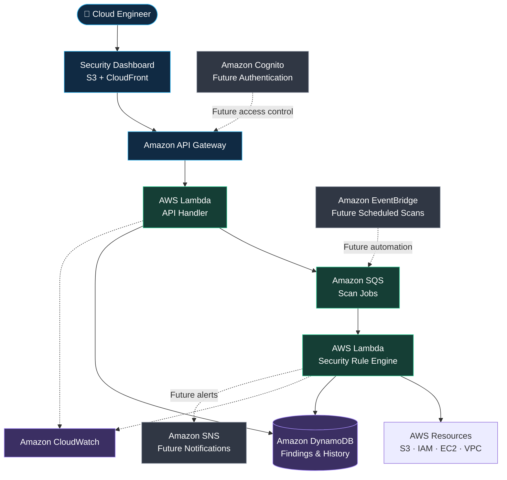

# 🛡️ CloudGuard AWS

### Cloud Security. Clear Findings. Safer Infrastructure.

**A serverless AWS security posture scanner designed to identify cloud misconfigurations, explain risks, and guide safer infrastructure decisions.**

<p align="center">
  
  
  
  
</p>

<p align="center">
  <b>DETECT</b> &nbsp; ◆ &nbsp; <b>ANALYZE</b> &nbsp; ◆ &nbsp; <b>PRIORITIZE</b> &nbsp; ◆ &nbsp; <b>REMEDIATE</b>
</p>

<p align="center">
  <a href="https://github.com/subhajitajodhya-dotcom/cloudguard-aws">Repository</a>
  &nbsp; • &nbsp;
  <a href="https://github.com/subhajitajodhya-dotcom/cloudguard-aws/issues">Issues</a>
  &nbsp; • &nbsp;
  <a href="https://github.com/subhajitajodhya-dotcom/cloudguard-aws/commits/main/">Development History</a>
</p>

---

> **🚧 Development status: Planning / Early Development**
>
> CloudGuard is currently in its planning stage. The architecture and features below describe the intended implementation, not a deployed or fully functional product.

## 🔐 The Mission

Cloud infrastructure is powerful—but a single misconfiguration can expose sensitive data, weaken access controls, or reduce visibility into suspicious activity.

CloudGuard AWS aims to make these issues easier to identify and understand by scanning selected AWS configurations and turning potential risks into structured, actionable security findings.

**The vision:** a lightweight, developer-friendly cloud security tool that helps engineers understand what is wrong, why it matters, and how to fix it safely.

## ✨ What CloudGuard Aims to Deliver

<table>
  <tr>
    <td width="50%">
      <h3>🔍 Security Detection</h3>
      Identify selected AWS configuration risks through rule-based security checks.
    </td>
    <td width="50%">
      <h3>🎯 Risk Prioritization</h3>
      Organize findings by severity and provide evidence for investigation.
    </td>
  </tr>
  <tr>
    <td width="50%">
      <h3>🛠️ Actionable Guidance</h3>
      Recommend practical remediation steps without automatically changing resources.
    </td>
    <td width="50%">
      <h3>⚙️ Infrastructure Automation</h3>
      Build reproducible cloud infrastructure with Terraform and automated validation.
    </td>
  </tr>
  <tr>
    <td width="50%">
      <h3>📊 Centralized Findings</h3>
      Store scan results and make them available for future dashboard visualization.
    </td>
    <td width="50%">
      <h3>🔐 Security by Design</h3>
      Prioritize least-privilege permissions, secure credentials, and controlled access.
    </td>
  </tr>
</table>

## 🚨 Security Problems in Scope

| Security area | Example risk | Intended outcome |
|---|---|---|
| Amazon S3 | Unintended public access | Flag potentially exposed storage |
| EC2 security groups | SSH or other sensitive ports open to the internet | Identify risky inbound rules |
| AWS IAM | Excessively permissive policies | Highlight permissions requiring review |
| AWS CloudTrail | Missing or insufficient audit logging | Identify gaps in activity visibility |
| Data in transit | Bucket policies that fail to enforce HTTPS | Recommend stronger transport protections |

*These are planned checks. Actual coverage will be documented as each rule is implemented and tested.*

## 🏗️ Proposed Architecture



### Architecture principles

- **Serverless first:** use managed AWS services where appropriate.
- **Least privilege:** isolate scanning, application and deployment permissions.
- **Infrastructure as Code:** define resources using Terraform.
- **Asynchronous processing:** introduce a queue when scan execution requires it.
- **Observable execution:** capture useful operational logs and errors.
- **Human-approved remediation:** identify and explain risks before changing infrastructure.

This diagram represents the target design. Components will be marked as implemented only after they exist and have been verified.

## 🧰 Technology Stack

<p>
  
  
  
  
  
</p>

| Layer | Planned technology |
|---|---|
| Application language | JavaScript / Node.js |
| AWS integration | AWS SDK for JavaScript v3 |
| Compute | AWS Lambda |
| API | Amazon API Gateway |
| Findings storage | Amazon DynamoDB |
| Infrastructure | Terraform |
| CI/CD | GitHub Actions |
| Local development | Docker |
| Monitoring | Amazon CloudWatch |
| Future dashboard | Amazon S3 + CloudFront |
| Future authentication | Amazon Cognito |

**Language choice:** CloudGuard is planned as a Node.js project, without Python.

## 🔄 How a Scan Will Work

1. **Initiate** — an authorized user requests a security scan.
2. **Inspect** — the scanner queries supported AWS configuration APIs.
3. **Evaluate** — security rules compare the observed configuration against defined criteria.
4. **Classify** — potential issues are assigned a severity and rule identifier.
5. **Record** — findings are stored with evidence and scan metadata.
6. **Recommend** — the system provides a suggested remediation.
7. **Verify** — an engineer reviews the fix and runs another scan.

### Example security finding

```json
{
  "ruleId": "NET-001",
  "severity": "HIGH",
  "title": "SSH exposed to the internet",
  "resourceType": "AWS::EC2::SecurityGroup",
  "status": "OPEN",
  "evidence": {
    "protocol": "tcp",
    "port": 22,
    "source": "0.0.0.0/0"
  },
  "recommendation": "Restrict SSH access to approved source IPs."
}
```

*Illustrative output only—not a finding from a completed scan.*

## 🛡️ Security Principles

| Principle | Implementation goal |
|---|---|
| Least privilege | Grant each identity only the permissions required |
| Read-only scanning | Avoid changing scanned AWS resources |
| Credential protection | Never commit credentials or secrets |
| Secure CI/CD | Prefer GitHub Actions OIDC for AWS federation |
| API authorization | Protect sensitive operations with appropriate access controls |
| Safe remediation | Require review before applying infrastructure changes |
| Auditability | Record useful events without exposing sensitive information |

## 🗺️ Development Roadmap

<details>
  <summary><b>Phase 1 — Security Scanner MVP</b></summary>

  - [ ] Create the Node.js application structure.
  - [ ] Define the security finding schema.
  - [ ] Build sample AWS configuration fixtures.
  - [ ] Implement the first security rule.
  - [ ] Add unit tests for safe and unsafe configurations.

  **Goal:** a tested local scanner.
</details>

<details>
  <summary><b>Phase 2 — AWS Integration</b></summary>

  - [ ] Integrate the AWS SDK for JavaScript.
  - [ ] Implement initial S3 and security-group checks.
  - [ ] Configure restricted scanning permissions.
  - [ ] Handle API errors and insufficient permissions.
  - [ ] Validate findings against a controlled AWS environment.

  **Goal:** a scanner that evaluates real AWS configurations.
</details>

<details>
  <summary><b>Phase 3 — Serverless Infrastructure</b></summary>

  - [ ] Define AWS resources with Terraform.
  - [ ] Deploy Lambda and API Gateway.
  - [ ] Store findings in DynamoDB.
  - [ ] Add CloudWatch logging and error handling.
  - [ ] Document deployment and cleanup.

  **Goal:** a working, reproducible AWS deployment.
</details>

<details>
  <summary><b>Phase 4 — CI/CD and Dashboard</b></summary>

  - [ ] Add automated unit tests.
  - [ ] Validate Terraform through GitHub Actions.
  - [ ] Add infrastructure and dependency security checks.
  - [ ] Build a dashboard for security findings.
  - [ ] Add filtering and scan history.

  **Goal:** a demonstrable end-to-end application.
</details>

<details>
  <summary><b>Phase 5 — Advanced Capabilities</b></summary>

  - [ ] Add Cognito authentication and authorization.
  - [ ] Add scheduled scanning.
  - [ ] Add asynchronous scan processing.
  - [ ] Configure optional security notifications.
  - [ ] Evaluate real-time updates and additional rules.

  **Goal:** a more complete security assessment platform.
</details>

## 🚀 Getting Started

### Prerequisites

- Git
- Node.js LTS and npm
- AWS CLI
- Terraform
- Docker
- An AWS account for live scanning and deployment

### Clone the repository

```bash
git clone https://github.com/subhajitajodhya-dotcom/cloudguard-aws.git
cd cloudguard-aws
```

### Verify your tools

```bash
node --version
npm --version
aws --version
terraform version
docker --version
```

The application-specific installation, test and deployment commands will be documented after the corresponding components have been implemented and verified.

**Safety note:** use a dedicated, restricted AWS identity. Review Terraform plans before applying them, configure billing alerts, and clean up test resources when finished.

## 🧪 Testing and Quality

CloudGuard will prioritize evidence-based development over unverified feature claims.

- Unit tests for individual security rules.
- Integration tests for AWS API interactions.
- API tests for input validation and authorization.
- Terraform formatting and validation.
- Automated checks through GitHub Actions.
- End-to-end verification in a controlled AWS environment.

Test coverage, security-check counts and deployment status will be published only when supported by actual results.

## 🎯 Project Goals

CloudGuard is intended to demonstrate practical skills in:

- AWS cloud engineering and serverless architecture.
- Security posture assessment and IAM permissions.
- Terraform and Infrastructure as Code.
- Node.js application development.
- CI/CD automation and testing.
- Monitoring, troubleshooting and technical documentation.

## 🔗 Related Project

**AWS Cloud Cost Optimization**

[Explore the companion project →](https://github.com/subhajitajodhya-dotcom/cloud-cost-optimization-aws)

CloudGuard focuses on security configuration, while the companion project focuses on cloud cost visibility and optimization. Together, they are intended to demonstrate two complementary aspects of cloud engineering.

## 👨‍💻 About the Developer

**Subhajit Dey** · Computer Science Student · Aspiring Cloud Engineer

Building hands-on projects to develop practical experience in AWS, infrastructure automation, security and DevOps.

[GitHub Profile](https://github.com/subhajitajodhya-dotcom) · [CloudGuard Repository](https://github.com/subhajitajodhya-dotcom/cloudguard-aws)

## 📜 License

A license has not yet been selected. Licensing information will be added when the license file is included in the repository.

---

<p align="center">
  <b>Build securely. Automate thoughtfully. Improve continuously.</b>
  <br/>
  <sub>CloudGuard AWS — A cloud security engineering project in development.</sub>
</p>
