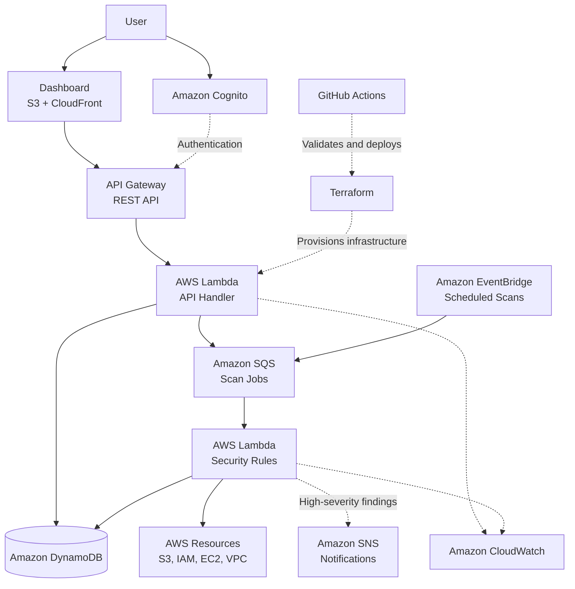

# 🛡️ CloudGuard AWS
### Serverless Cloud Security Posture Scanner

**Detect AWS security misconfigurations. Understand the risk. Review recommended fixes.**

CloudGuard AWS is a portfolio project designed to assess common AWS security misconfigurations through a serverless architecture. The goal is to turn cloud configuration checks into clear, actionable findings that developers and cloud engineers can investigate and resolve safely.

> 🚧 **Project Status: Planning / Early Development**
>
> The repository currently contains the project plan and architecture. Features described below are proposed capabilities unless explicitly marked as implemented. The roadmap will be updated as working components are built and tested.

[Repository](https://github.com/subhajitajodhya-dotcom/cloudguard-aws) · [Report an Issue](https://github.com/subhajitajodhya-dotcom/cloudguard-aws/issues) · [Related Project: AWS Cost Optimization](https://github.com/subhajitajodhya-dotcom/cloud-cost-optimization-aws)

---

## 📑 Table of Contents

- [Overview](#-overview)
- [The Problem](#-the-problem)
- [Project Goals](#-project-goals)
- [Planned Features](#-planned-features)
- [Security Checks](#-security-checks)
- [Architecture](#-architecture)
- [Technology Stack](#-technology-stack)
- [How It Will Work](#-how-it-will-work)
- [Security by Design](#-security-by-design)
- [Project Structure](#-project-structure)
- [Development Roadmap](#-development-roadmap)
- [Getting Started](#-getting-started)
- [Testing Strategy](#-testing-strategy)
- [Cost and Cleanup](#-cost-and-cleanup)
- [Limitations](#-limitations)
- [Related Project](#-related-project)
- [About the Developer](#-about-the-developer)

---

## 🎯 Overview

CloudGuard AWS aims to provide a focused, serverless approach to identifying common cloud security configuration issues.

Instead of simply listing AWS resources, the scanner will evaluate selected configurations against explicit security rules and generate structured findings containing the affected resource, severity, evidence and recommended remediation.

### Core objectives

- 🔍 **Detect:** Identify selected AWS security misconfigurations.
- 📋 **Explain:** Describe what was detected and why it matters.
- 🎯 **Prioritize:** Classify findings by severity.
- 🛠️ **Recommend:** Provide actionable remediation guidance.
- 📊 **Monitor:** Present findings through an API and dashboard.
- 🔐 **Protect:** Use read-only scanning permissions and least-privilege access wherever possible.
- ⚙️ **Automate:** Manage infrastructure through Terraform and validate changes through CI/CD.

The initial release will focus on a small set of reliable security checks before expanding into authentication, scheduled scans and dashboard enhancements.

---

## 🚨 The Problem

Cloud environments can become vulnerable through ordinary configuration mistakes, including:

- Publicly accessible storage resources.
- Security groups that expose sensitive ports to the internet.
- Overly permissive IAM policies.
- Missing or insufficient audit logging.
- Weak access-key management practices.

Finding these issues is only part of the challenge. Engineers also need to understand their impact, prioritize fixes and verify that the configuration has improved.

**CloudGuard aims to connect detection with understandable remediation guidance in one focused workflow.**

---

## ✨ Planned Features

| Feature | Purpose | Status |
|---|---|---|
| Rule-based security scanner | Evaluate selected AWS configurations | Planned |
| Structured security findings | Store evidence, severity and remediation | Planned |
| AWS Lambda backend | Execute serverless application logic | Planned |
| REST API | Retrieve findings and trigger authorized scans | Planned |
| DynamoDB persistence | Store findings and scan metadata | Planned |
| Terraform infrastructure | Reproducible infrastructure deployment | Planned |
| Docker development environment | Consistent local development and testing | Planned |
| GitHub Actions CI/CD | Automate tests and infrastructure validation | Planned |
| Amazon Cognito authentication | Authenticate dashboard users | Planned |
| Viewer and admin roles | Separate read and administrative actions | Planned |
| Scheduled scans and notifications | Detect issues and alert users | Planned |
| Dashboard with live updates | Visualize scan progress and findings | Future milestone |

The initial version will prioritize the scanner, its tests and the API. Advanced features will be added only when the core workflow works reliably.

---

## 🔎 Security Checks

The first version is intended to focus on a small number of high-value checks.

| Service / Area | Proposed check | Why it matters |
|---|---|---|
| Amazon S3 | Public access protection | Helps prevent unintended public exposure |
| Amazon S3 | Bucket policy enforces HTTPS | Helps protect data in transit |
| Amazon EC2 / VPC | Sensitive ports exposed to `0.0.0.0/0` | May allow unwanted internet access |
| AWS IAM | Excessively permissive policies | Reduces unnecessary permissions |
| AWS IAM | Access-key age and rotation review | Helps identify credentials requiring review |
| AWS CloudTrail | Audit trail configuration | Supports account activity monitoring |

These checks are a proposed initial scope, not a claim of current scanner coverage. Each rule will need an implementation, test cases and documented permissions before being marked complete.

### Example finding

The following is an illustrative example of the intended output format, not a result from a live scan.

```json
{
  "ruleId": "NET-001",
  "resourceType": "AWS::EC2::SecurityGroup",
  "severity": "HIGH",
  "title": "SSH exposed to the internet",
  "status": "OPEN",
  "evidence": {
    "port": 22,
    "protocol": "tcp",
    "source": "0.0.0.0/0"
  },
  "recommendation": "Restrict SSH access to approved source IPs."
}
```

A finding should provide enough evidence for an engineer to understand the issue and decide what to do next.

---

## 🏗️ Architecture

The following diagram represents the **proposed target architecture**. It is not a diagram of infrastructure already deployed.



### Architecture components

| Component | Responsibility |
|---|---|
| Amazon API Gateway | Expose controlled API endpoints |
| AWS Lambda | Handle API requests and execute security checks |
| Amazon SQS | Queue scan jobs for asynchronous processing |
| Amazon EventBridge | Trigger scheduled scans |
| Amazon DynamoDB | Store findings and scan metadata |
| Amazon Cognito | Authenticate users in a later milestone |
| Amazon SNS | Deliver configured security notifications |
| Amazon CloudWatch | Centralize logs and operational monitoring |
| Amazon S3 and CloudFront | Host the proposed dashboard |
| Terraform | Define and provision AWS infrastructure |
| GitHub Actions | Automate testing and deployment workflows |
| Docker | Provide a consistent local development environment |

**Architecture principle:** build and verify the essential scan workflow first. Add queuing, authentication and real-time updates when the simpler version is stable.

---

## 🧰 Technology Stack

| Category | Technology |
|---|---|
| Programming language | JavaScript / Node.js |
| Cloud provider | Amazon Web Services |
| AWS SDK | AWS SDK for JavaScript v3 |
| Serverless compute | AWS Lambda |
| API layer | Amazon API Gateway |
| Storage | Amazon DynamoDB |
| Messaging and scheduling | Amazon SQS, EventBridge and SNS |
| Authentication | Amazon Cognito |
| Monitoring | Amazon CloudWatch |
| Infrastructure as Code | Terraform |
| Containerization | Docker |
| CI/CD | GitHub Actions |
| Dashboard hosting | Amazon S3 and CloudFront |

The application is intended to use Node.js, including for Lambda functions. **Python is not part of the planned application stack.**

Some services may be introduced only after the initial MVP is complete.

---

## ⚙️ How It Will Work

The intended end-to-end workflow is:

1. **Initiate a scan:** An authorized user or scheduled event starts a scan.
2. **Execute security rules:** The scanner queries supported AWS configuration APIs.
3. **Evaluate configurations:** Each rule compares observed settings with its defined criteria.
4. **Generate findings:** Failed checks produce structured findings with evidence and severity.
5. **Persist results:** Scan metadata and findings are saved for retrieval and review.
6. **Notify when appropriate:** Configured alerts can notify users about selected high-severity findings.
7. **Review remediation:** An engineer investigates the recommendation and approves any required change.
8. **Verify the result:** A subsequent scan checks whether the original condition remains.

The scanner is intended to be read-only. It should not automatically modify production resources as part of the initial release.

---

## 🔐 Security by Design

Security is a core design requirement, not an optional enhancement.

- **Least privilege:** Grant each component only the permissions it needs.
- **Read-only scanning:** Separate scanning permissions from infrastructure deployment permissions.
- **No hard-coded credentials:** Never commit AWS access keys, tokens or other secrets.
- **OIDC for CI/CD:** Prefer GitHub Actions OpenID Connect federation over long-lived AWS access keys.
- **Protected APIs:** Require authentication and authorization for protected operations when authentication is introduced.
- **Input validation:** Validate API inputs and reject invalid scan requests.
- **Auditability:** Record operational events and errors without logging secrets.
- **Approval before remediation:** Present proposed changes for human review rather than automatically applying them.
- **Safe infrastructure changes:** Review Terraform plans before applying them to a real AWS account.

Security controls must be implemented and tested before being described as active protections.

---

## 📁 Project Structure

The following is the proposed repository structure as development progresses.

```text
cloudguard-aws/
├── app/
│   ├── api/
│   │   └── handlers/
│   ├── scanner/
│   │   ├── engine.js
│   │   └── rules/
│   ├── services/
│   └── utils/
├── tests/
│   ├── unit/
│   └── fixtures/
├── frontend/
├── terraform/
│   ├── modules/
│   └── environments/
│       ├── dev/
│       └── prod/
├── docker/
├── docs/
├── .github/
│   └── workflows/
├── .gitignore
├── package.json
└── README.md
```

Files and directories will be introduced as they become necessary. The structure is a design proposal and does not imply that these files currently exist.

---

## 🗺️ Development Roadmap

The project will be developed incrementally, with working deliverables at each stage.

### Phase 1 — Foundation

- [ ] Finalize the Node.js project structure.
- [ ] Define the finding data model.
- [ ] Create sample AWS configuration fixtures.
- [ ] Implement the first security rule.
- [ ] Add unit tests for safe and unsafe configurations.

**Milestone:** a local security checker that produces a verified finding.

### Phase 2 — AWS integration

- [ ] Connect the scanner to AWS using the SDK for JavaScript.
- [ ] Implement initial S3 and security-group checks.
- [ ] Configure dedicated read-only permissions.
- [ ] Handle API errors and missing permissions.
- [ ] Validate results against a controlled test environment.

**Milestone:** the scanner can inspect selected real AWS configurations safely.

### Phase 3 — Serverless backend

- [ ] Define the infrastructure with Terraform.
- [ ] Deploy the Lambda scanner and REST API.
- [ ] Store findings in DynamoDB.
- [ ] Add structured logs and error handling.
- [ ] Document deployment and cleanup procedures.

**Milestone:** scan findings can be retrieved through a deployed API.

### Phase 4 — Delivery and reliability

- [ ] Add GitHub Actions for tests and code validation.
- [ ] Validate Terraform formatting and configuration.
- [ ] Add dependency and infrastructure security checks.
- [ ] Build a basic dashboard.
- [ ] Add scan history and severity filtering.

**Milestone:** a reproducible application with an automated validation workflow.

### Phase 5 — Advanced capabilities

- [ ] Add Cognito authentication and role-based authorization.
- [ ] Add scheduled scans through EventBridge.
- [ ] Add SQS-based asynchronous scan execution where needed.
- [ ] Configure SNS notifications.
- [ ] Add live dashboard updates if justified.
- [ ] Improve coverage, documentation and demo quality.

**Milestone:** a more complete cloud security assessment application.

---

## 🚀 Getting Started

> Setup instructions will be finalized after the first working implementation is committed. The commands below prepare the development environment; they do not currently deploy CloudGuard.

### Prerequisites

- Git
- Node.js LTS and npm
- Visual Studio Code or another code editor
- AWS CLI for AWS integration
- An AWS account for live scanning and deployment
- Terraform for infrastructure deployment
- Docker for container-based development and testing

### 1. Clone the repository

```bash
git clone https://github.com/subhajitajodhya-dotcom/cloudguard-aws.git
cd cloudguard-aws
```

### 2. Check your development tools

```bash
node --version
npm --version
git --version
terraform version
docker --version
```

Install the tools that are missing. Terraform and Docker will be needed when their respective development stages begin.

### 3. Configure AWS securely

Use an approved local AWS profile or another supported credential provider. Avoid using the AWS root user for development.

```bash
aws configure --profile cloudguard-dev
aws sts get-caller-identity --profile cloudguard-dev
```

The configuration command prompts for credentials. Do not place real credentials in source files or commit them to GitHub. Use a dedicated, appropriately restricted identity for scanning.

### 4. Run the application

The application-specific installation and run commands will be added once the Node.js entry point, dependencies and scripts have been implemented and tested.

---

## 🧪 Testing Strategy

Testing will validate individual rules as well as the complete scan workflow.

| Test level | Objective |
|---|---|
| Unit tests | Verify each security rule against safe and unsafe fixtures |
| Integration tests | Validate interactions between the scanner and AWS APIs |
| API tests | Verify request validation, authorization and responses |
| Infrastructure validation | Check Terraform formatting and configuration |
| CI/CD checks | Run automated tests before changes are merged or deployed |
| End-to-end tests | Confirm the scan-to-finding workflow in a controlled environment |

The project will not claim test coverage percentages, deployment success or security guarantees without corresponding evidence.

---

## 💰 Cost and Cleanup

CloudGuard is intended as a learning and portfolio project, with cost-conscious infrastructure choices.

AWS services may incur charges depending on usage, region, configuration and account eligibility. Before deploying:

- Configure an AWS Budget and billing alerts.
- Review the estimated cost of each service.
- Avoid unnecessary always-on resources.
- Use a development environment for testing.
- Inspect Terraform plans before deployment.
- Destroy temporary infrastructure when it is no longer needed.

When resources have been deployed through Terraform, review the active workspace and configuration before running:

```bash
terraform plan -destroy
terraform destroy
```

Run these commands only from the correct Terraform environment. They can delete infrastructure and associated resources.

Deleting infrastructure does not necessarily delete every external resource, log, stored object or outstanding charge, so verify cleanup separately.

---

## ⚠️ Limitations

CloudGuard is intended to be a focused security assessment tool, not a replacement for a complete cloud security platform.

- Its coverage will be limited to implemented and tested rules.
- Findings depend on the permissions and resources available to the scanner.
- A successful check does not prove that an AWS account is completely secure.
- Severity labels are project-defined classifications, not guarantees of actual business impact.
- Remediation recommendations require review against the target environment.
- Multi-account scanning, automated remediation and advanced analytics are not part of the initial MVP.

These boundaries will be updated as the implementation evolves.

---

## 🔗 Related Project

### AWS Cloud Cost Optimization

[View the Cloud Cost Optimization project](https://github.com/subhajitajodhya-dotcom/cloud-cost-optimization-aws)

The two projects have complementary goals:

| Project | Primary focus |
|---|---|
| AWS Cloud Cost Optimization | Identify opportunities to understand and reduce cloud spending |
| CloudGuard AWS | Identify selected cloud security misconfigurations |

Together, they are intended to demonstrate practical skills across AWS operations, infrastructure automation, monitoring and cloud security.

---

## 👨‍💻 About the Developer

**Subhajit Dey**

Computer Science student focused on developing practical skills in AWS cloud engineering, infrastructure as code, automation and DevOps.

CloudGuard AWS is being developed as a hands-on learning project to explore how serverless systems, security rules, infrastructure automation and testing work together.

- GitHub: [@subhajitajodhya-dotcom](https://github.com/subhajitajodhya-dotcom)
- Project: [CloudGuard AWS](https://github.com/subhajitajodhya-dotcom/cloudguard-aws)

---

## 📜 License

A license has not yet been specified. Licensing information will be added when a license is selected and included in the repository.

---

*Built incrementally. Tested deliberately. Designed with security in mind.*
