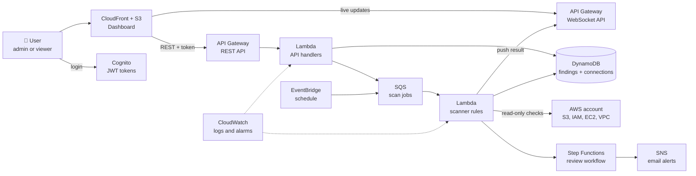

<div align="center">

# 🛡️ CloudGuard

### Serverless AWS Security Posture Scanner

Find security misconfigurations in your AWS account, see them live on a dashboard, and fix them with approval.


</div>

---

> 🚧 **Project status:** CloudGuard is being built step by step. This README describes the design and shows what is done and what is next. The checklist in [Roadmap](#-roadmap) is updated as each part is finished.

## 📖 Table of Contents

- [Why CloudGuard](#-why-cloudguard)
- [Features](#-features)
- [Architecture](#-architecture)
- [Tech Stack](#-tech-stack)
- [Security Checks](#-security-checks)
- [API Design](#-api-design)
- [Authentication and Roles](#-authentication-and-roles)
- [Planned Folder Structure](#-planned-folder-structure)
- [Roadmap](#-roadmap)
- [Getting Started](#-getting-started)
- [Related Project](#-related-project)
- [Author](#-author)

---

## 🎯 Why CloudGuard

Most cloud security problems are not clever attacks. They are simple misconfigurations: a public storage bucket, a firewall open to the world, or an access key nobody rotated.

Recent industry research on AWS accounts found weak IAM controls, missing public access protection on S3 and unrotated access keys to be very common ([2026 Cloud Security Index](https://cloudsecurityalliance.org/blog/2026/09/04/2026-cloud-security-index-how-risk-differs-across-aws-azure-and-google-cloud-csa)).

CloudGuard checks for these problems automatically, shows the results in real time, and keeps a history so you can see whether your security is improving.

---

## ✨ Features

- 🔍 **Automated scans** of an AWS account on a schedule or on demand
- 🔐 **Login with roles**: `admin` can approve fixes, `viewer` can only read
- 🌐 **REST API** for findings, scans and fixes
- ⚡ **WebSocket API** that pushes scan progress and new findings to the dashboard live
- 📊 **Dashboard** with a security score and findings by severity
- 🔔 **Email alerts** for high-severity findings
- 🏗️ **Everything created with Terraform**, with separate `dev` and `prod` environments
- 🚀 **CI/CD** with GitHub Actions: test, scan, plan and deploy
- 🐳 **Docker** for local development and CI builds
- 🧩 **Rule plug-in design**: a new security check is one small file
- 🏢 **Multi-account scanning** by assuming a read-only role *(planned)*

---

## 🏛️ Architecture



---

## 🛠️ Tech Stack

| Area | Tool |
|---|---|
| Compute | AWS Lambda (Python) |
| APIs | API Gateway (REST and WebSocket) |
| Data | DynamoDB |
| Auth | Amazon Cognito (JWT) |
| Messaging | SQS, SNS, EventBridge, Step Functions |
| Frontend hosting | S3 and CloudFront |
| Monitoring | CloudWatch |
| Infrastructure as Code | Terraform |
| Containers | Docker, Docker Compose |
| CI/CD | GitHub Actions (OIDC login, no stored AWS keys) |
| Security tooling | Trivy, Terraform security checks, secret scanning |

---

## 🔒 Security Checks

CloudGuard starts with checks for common AWS misconfigurations. Each check is one rule with a severity and a fix suggestion.

| Area | Check |
|---|---|
| **S3** | Block Public Access is enabled |
| **S3** | Bucket policy enforces HTTPS |
| **Network** | Security groups do not allow `0.0.0.0/0` on sensitive ports (SSH, RDP, databases) |
| **Network** | Subnets do not auto-assign public IPs without a reason |
| **IAM** | Access keys are rotated within 90 days |
| **IAM** | Policies are attached to groups or roles, not directly to users |
| **IAM** | No wildcard (`*`) admin policies on users |
| **Account** | Root account has no active access keys |
| **Logging** | A CloudTrail trail is enabled |

> The list grows as new rules are added. Rules marked in the [Roadmap](#-roadmap) are the ones implemented so far.

---

## 🔌 API Design

**REST API** (planned endpoints, all require a valid token)

| Method | Path | Role | What it does |
|---|---|---|---|
| `GET` | `/findings` | viewer, admin | List findings, filter by severity |
| `GET` | `/findings/{id}` | viewer, admin | Details and fix suggestion |
| `POST` | `/scans` | admin | Start a scan now |
| `GET` | `/scans/{id}` | viewer, admin | Scan status |
| `POST` | `/findings/{id}/resolve` | admin | Approve or mark a finding resolved |
| `GET` | `/score` | viewer, admin | Current security score |

**WebSocket API** (planned events)

| Event | When it is sent |
|---|---|
| `scan.started` | A scan begins |
| `finding.created` | A new finding is stored |
| `scan.completed` | A scan finishes, with a summary |

---

## 🔑 Authentication and Roles

- Users sign in through **Amazon Cognito** and receive a JWT token.
- The REST API verifies the token on every request.
- The WebSocket connection is checked when it opens.
- Cognito **groups** decide what a user may do:

| Role | Can do |
|---|---|
| `viewer` | Read findings, scans and the score |
| `admin` | Everything a viewer can, plus start scans and approve fixes |

- Each Lambda function has its own **least-privilege IAM role**.
- The scanner uses **read-only** permissions.
- GitHub Actions deploys through **OIDC**, so no AWS access keys are stored in the repository.

---

## 📂 Planned Folder Structure

```
cloudguard-aws/
├── app/                 # Lambda code: API handlers and scanner rules
│   ├── api/
│   ├── scanner/
│   │   └── rules/       # one file per security check
│   └── tests/
├── frontend/            # Dashboard
├── terraform/           # Infrastructure (modules, dev and prod)
├── docker/              # Local development setup
├── .github/workflows/   # CI/CD pipelines
├── docs/                # Architecture, design decisions, runbook, API spec
├── screenshots/
└── README.md
```

---

## 🗺️ Roadmap

**Week 1: Foundation**
- [ ] AWS free tier checked, budget alert set
- [ ] Repository created, project structure added
- [ ] Local app running with Docker Compose

**Week 2: Backend**
- [ ] Terraform: DynamoDB, Lambda, REST API
- [ ] First scanner rules (S3 and security groups)
- [ ] Findings stored and returned by the API

**Week 3: Security and real time**
- [ ] IAM rules (keys, policies, root account)
- [ ] Cognito login with `admin` and `viewer` roles
- [ ] WebSocket live updates

**Week 4: Delivery**
- [ ] CI/CD with GitHub Actions (test, scan, plan, deploy)
- [ ] Dashboard
- [ ] CloudWatch dashboard and alarms

**Week 5 and 6: Quality layer**
- [ ] Unit tests for every rule, with a coverage badge
- [ ] Reliability: retries, dead-letter queue, safe re-runs
- [ ] Multi-account scanning
- [ ] Design notes, runbook and API spec
- [ ] Demo video and screenshots

---

## 🚀 Getting Started

Setup instructions will be added once the first working version is deployed.

---

## 🔗 Related Project

[**Cloud Cost Optimization on AWS**](https://github.com/subhajitajodhya-dotcom/cloud-cost-optimization-aws): Terraform, Docker, Prometheus, Grafana and PowerShell automation to monitor and reduce AWS cost.

CloudGuard complements it: that project optimizes cost and monitors infrastructure, and CloudGuard secures it.

---

## 👨‍💻 Author

**Subhajit Dey**

[](https://github.com/subhajitajodhya-dotcom)

---

<div align="center">

⭐ *Built step by step with curiosity and hands-on practice.*

</div>
