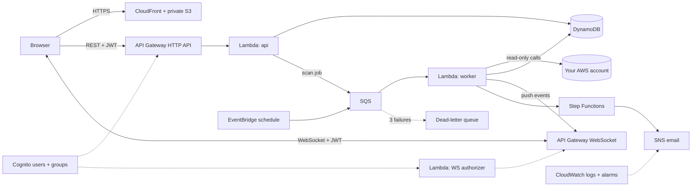

# CloudGuard — Serverless AWS Security Posture Scanner

Scans an AWS account for security mistakes, scores it, shows the results on a live dashboard, and emails an alert when new serious problems appear. Runs on serverless AWS, deploys with Terraform, and costs about **$0** at demo scale.

   

> Companion to my [Cloud Cost Optimization](https://github.com/subhajitajodhya-dotcom) project: that one saves money, this one reduces risk.

## What it does

- **11 security rules** across S3, network (security groups, subnets), IAM and account settings. Each finding says what is wrong and how to fix it.
- **Security score** (100 minus weighted open findings) and a findings lifecycle: `open` → `resolved` (a person accepts it) or `fixed` (a later scan no longer sees it).
- **Live dashboard**: scan progress and new findings appear in the browser through a WebSocket, no refresh.
- **Role-based access**: `admin` can start scans and resolve findings, `viewer` is read-only.
- **Alerts**: a Step Functions workflow emails you only when a scan finds *new* HIGH or CRITICAL problems.
- **Multi-account**: a scan can assume a read-only role in another account (from an allow-list).

## Architecture



## Services used (all free-tier friendly)

Lambda · API Gateway (HTTP + WebSocket) · Cognito · DynamoDB · SQS (+DLQ) · SNS · Step Functions · EventBridge · S3 · CloudFront · CloudWatch · IAM · STS

## Tech

| Area | What |
|---|---|
| Infrastructure | Terraform, S3 remote state with locking, `dev`/`prod` variable files |
| CI/CD | GitHub Actions: ruff, pytest, `terraform validate`, Trivy; deploy through **OIDC** (no AWS keys stored) |
| Containers | Docker + Compose for tests, lint and local dashboard |
| APIs | REST-style (API Gateway HTTP API) and WebSocket |
| AuthN / AuthZ | Cognito JWT; groups `admin` / `viewer`; API checks the role on every route |
| Testing | pytest + moto, 47 tests (rules, API roles, JWT edge cases, worker, idempotency) |

## Security decisions (the interesting part)

- **Least privilege per function.** Each Lambda has its own IAM role. The scanner role has read-only actions only.
- **Confused-deputy protection.** Another account's role can only be scanned if it is in `allowed_role_arns`.
- **WebSocket auth.** Token verified in a Lambda authorizer: RS256 signature, issuer, expiry, token type, app id, and group. `alg: none` and tokens from other apps are rejected (tested).
- **No self sign-up**, 12-character passwords, optional MFA, private S3 bucket reachable only through CloudFront.
- **Safe scanning.** A broken rule never stops a scan; findings are only marked `fixed` for rules that succeeded and regions that were scanned.
- **Idempotent.** Finding IDs are a hash of account + rule + resource + region, so scanning twice never duplicates.

More in [docs/DECISIONS.md](docs/DECISIONS.md).

## Run it

Full step-by-step: **[docs/DEPLOY.md](docs/DEPLOY.md)**

```bash
docker compose run --rm test      # run tests in Docker
python scripts/package.py         # build the Lambda zip
cd terraform && terraform init -backend-config="bucket=<state-bucket>" \
  && terraform apply -var-file=envs/dev.tfvars -var alert_email=you@example.com
```

## REST API

| Route | Role | Purpose |
|---|---|---|
| `GET /me` | any | who am I, my roles |
| `GET /findings?severity=&status=` | viewer | list findings |
| `GET /findings/{id}` | viewer | one finding |
| `POST /findings/{id}/resolve` | admin | accept a finding with a note |
| `POST /scans` | admin | queue a scan (returns 202) |
| `GET /scans`, `GET /scans/{id}` | viewer | scan history |
| `GET /score` | viewer | score and counts |

WebSocket events: `scan.started`, `finding.created`, `scan.completed`, `scan.failed`.

## Rules

| ID | Check | Severity |
|---|---|---|
| S3-001 | Bucket without Block Public Access | HIGH |
| S3-002 | Bucket allows plain HTTP | MEDIUM |
| NET-001 | Sensitive port open to the world | HIGH / CRITICAL |
| NET-002 | Subnet auto-assigns public IPs | LOW |
| IAM-001 | Access key older than 90 days | MEDIUM |
| IAM-002 | Policy attached directly to a user | LOW |
| IAM-003 | User has AdministratorAccess | HIGH |
| IAM-004 | Console user without MFA | HIGH |
| ACC-001 | Root account has access keys | CRITICAL |
| ACC-002 | Root account has no MFA | CRITICAL |
| ACC-003 | No active CloudTrail | HIGH |

Add a rule: write one function with `@rule("ID", "description")` in `app/scanner/rules/` and add a test. It is picked up automatically.

## Screenshots

_Add after your first deploy: create a `screenshots/` folder with `dashboard.png` and `live-feed.png`._

## Cost and cleanup

Everything is pay-per-use. A demo costs cents or nothing. Remove it all with `terraform destroy` (see DEPLOY.md).

## Limits (honest)

Scans one account per request, a fixed rule set (not a replacement for AWS Security Hub / Config), and a single DynamoDB partition for findings, which is fine for thousands of findings, not millions.
